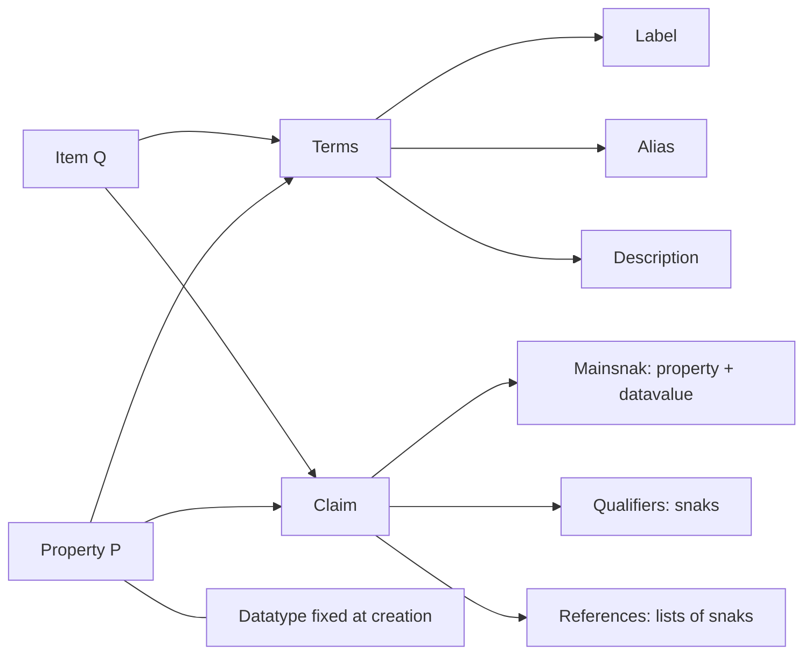

# Wikibase API operations

Everything the API tests in `test/api/` do to Wikibase, plus the fixtures they
take from `test/conftest.py`.

- All tests are marked `integration` and write to the live instance at
  `settings.mediawiki_api_url` with the user account
  (`WikibaseAuthenticator.login_as_user()`).
- The public API creates entities; it has no delete. Every run leaves one
  Q-id or P-id per written entity behind.
- One `write()` sends the whole entity: the shell, its terms, and its claims
  travel in the same payload. There is no separate "add label" request.

## Shape of what is ingested

## Operation catalog

### Session

| Operation               | Call                                                                                                                           | Notes                                                                                |
| ----------------------- | ------------------------------------------------------------------------------------------------------------------------------ | ------------------------------------------------------------------------------------ |
| Log in as the wiki user | `WikibaseAuthenticator.login_as_user()` → `wbi_login.Clientlogin(user=..., password=..., mediawiki_api_url=..., verify=False)` | Writes need the user account. Returns `None` on failure; the tests assert it is set. |
| Open the client         | `WikibaseIntegrator(login=login)`                                                                                              | One client per test module or session.                                               |

### Create an item

| Operation         | Call                                    | Notes                                                                      |
| ----------------- | --------------------------------------- | -------------------------------------------------------------------------- |
| New, unsaved item | `wbi.item.new()`                        | Returns an item shell with no id yet.                                      |
| Set a label       | `item.labels.set(language, text)`       | Per language; the tests use `en` and `fr`.                                 |
| Set an alias      | `item.aliases.set(language, text)`      | The setter takes one string; the API serves back a list of aliases.        |
| Set a description | `item.descriptions.set(language, text)` | Per language.                                                              |
| Write the item    | `item.write()`                          | Allocates the Q-id; returns the written item, whose `.id` is the new Q-id. |

### Create a property

| Operation             | Call                                                         | Notes                                                                                                           |
| --------------------- | ------------------------------------------------------------ | --------------------------------------------------------------------------------------------------------------- |
| New, unsaved property | `wbi.property.new()`                                         | Returns a property shell with no id yet.                                                                        |
| Set the datatype      | `property.datatype = WikibaseDatatype.<X>`                   | Required: a property without one is refused. Fixed at creation; a later write with another datatype is ignored. |
| Set terms             | `property.labels.set(...)`, `property.descriptions.set(...)` | Both optional; a property may have no terms, a label only, or a description only.                               |
| Write the property    | `property.write()`                                           | Allocates the P-id.                                                                                             |
| Rewrite the property  | `property.write()` again                                     | A second write with a different datatype leaves the stored datatype unchanged.                                  |

### Claims

| Operation                                  | Call                                                                     | Notes                                                                                                                                      |
| ------------------------------------------ | ------------------------------------------------------------------------ | ------------------------------------------------------------------------------------------------------------------------------------------ |
| Add a claim                                | `entity.claims.add(datatypes.<X>(prop_nr=..., ...))`                     | Works on an item (`wbi.item.new()`) and on a property (`wbi.property.new()`). The default replaces an existing claim on the same property. |
| Append a second claim on the same property | `entity.claims.add(claim, action_if_exists=ActionIfExists.FORCE_APPEND)` | Without `FORCE_APPEND` the second claim on a property replaces the first. Stored order follows the add order.                              |
| Add a claim to a property entity           | `property.claims.add(datatypes.String(prop_nr=..., value=...))`          | A claim is not an item-only shape.                                                                                                         |
| Read claims by property                    | `stored.claims.get(prop_nr)`                                             | Returns a list, in stored order.                                                                                                           |
| Read the main snak                         | `claim.mainsnak.property_number`                                         | The property the claim names.                                                                                                              |
| Read the main value                        | `claim.mainsnak.datavalue`                                               | `{"type": ..., "value": ...}`; `type` is the datavalue type from section 3.                                                                |

### Qualifiers

| Operation                      | Call                                                  | Notes                                                                                                                            |
| ------------------------------ | ----------------------------------------------------- | -------------------------------------------------------------------------------------------------------------------------------- |
| Build a qualifier set          | `Qualifiers()` then `qualifiers.add(snak)`            | A qualifier is a snak: `datatypes.<X>(prop_nr=..., value=...)`.                                                                  |
| Attach qualifiers to a claim   | `datatypes.<X>(..., qualifiers=qualifiers)`           | Passed to the claim constructor, not added after the write.                                                                      |
| Read the qualifiers of a claim | `claim.qualifiers.get(prop_nr)`                       | Returns the qualifier snaks for that property.                                                                                   |
| Read a qualifier snak          | `snak.property_number`, `snak.datavalue`, `snak.hash` | The wiki hashes the snak and serves the 40-hex hash back. The qualifier is stored inside the statement, not as a separate claim. |

### References

| Operation                    | Call                                            | Notes                                                                                                                                      |
| ---------------------------- | ----------------------------------------------- | ------------------------------------------------------------------------------------------------------------------------------------------ |
| Build one reference          | `Reference()` then `reference.add(snak)`        | One reference holds one or more snaks.                                                                                                     |
| Build the reference list     | `References()` then `references.add(reference)` | Order is preserved.                                                                                                                        |
| Attach references to a claim | `datatypes.<X>(..., references=references)`     | Passed to the claim constructor.                                                                                                           |
| Read the references          | `claim.references.references`                   | Returns a list of `Reference`. Per reference: `reference.snaks.get(prop_nr)`, `reference.hash`, and `reference.snaks.snaks` for all snaks. |
| Empty reference is dropped   | `References().add(Reference())`                 | A reference with no snak is stored nowhere; the write still succeeds and only the non-empty references remain.                             |

### Read back

| Operation         | Call                                                                                   | Notes                                                                                                             |
| ----------------- | -------------------------------------------------------------------------------------- | ----------------------------------------------------------------------------------------------------------------- |
| Fetch an item     | `wbi.item.get(entity_id)`                                                              | The item as the API serves it back, not as it was sent.                                                           |
| Fetch a property  | `wbi.property.get(entity_id)`                                                          | Also used in `conftest` to poll `.datatype` until the wiki serves it.                                             |
| Raw entity JSON   | `entity.get_json()`                                                                    | Raw Wikibase JSON: `claims`, `labels`, `descriptions`, `aliases`, `datatype`, `id`.                               |
| Read terms        | `entity.labels.get(lang)`, `entity.descriptions.get(lang)`, `entity.aliases.get(lang)` | Labels and descriptions return strings; aliases return a list of alias objects (`.value`). Missing term → `None`. |
| Read the datatype | `stored.datatype` (enum) / `stored.get_json()["datatype"]` (string)                    | The enum and the JSON string are both checked against the written datatype.                                       |

## Claim datatypes

| Wikibase datatype                  | Constructor and arguments used                                                                                                      | Stored `datavalue.type` | Stored `datavalue.value` (as asserted)                                                                              |
| ---------------------------------- | ----------------------------------------------------------------------------------------------------------------------------------- | ----------------------- | ------------------------------------------------------------------------------------------------------------------- |
| `WikibaseDatatype.STRING`          | `datatypes.String(prop_nr=..., value=f"A string value {token}")`                                                                    | `string`                | the string                                                                                                          |
| `WikibaseDatatype.EXTERNALID`      | `datatypes.ExternalID(prop_nr=..., value=f"external-{token}")`                                                                      | `string`                | the string                                                                                                          |
| `WikibaseDatatype.EDTF`            | `datatypes.EDTF(prop_nr=..., value="2020-01-01")`                                                                                   | `string`                | `"2020-01-01"`                                                                                                      |
| `WikibaseDatatype.URL`             | `datatypes.URL(prop_nr=..., value=f"https://example.org/{token}")`                                                                  | `string`                | the URL                                                                                                             |
| `WikibaseDatatype.TIME`            | `datatypes.Time(prop_nr=..., time="+2020-01-01T00:00:00Z")`                                                                         | `time`                  | `{time, timezone: 0, before: 0, after: 0, precision: 11, calendarmodel: "http://www.wikidata.org/entity/Q1985727"}` |
| `WikibaseDatatype.QUANTITY`        | `datatypes.Quantity(prop_nr=..., amount=42, upper_bound=43, lower_bound=41, unit="1")`                                              | `quantity`              | `{amount: "+42", unit: "1", upperBound: "+43", lowerBound: "+41"}`                                                  |
| `WikibaseDatatype.MONOLINGUALTEXT` | `datatypes.MonolingualText(prop_nr=..., text=..., language="en")`                                                                   | `monolingualtext`       | `{text, language: "en"}`                                                                                            |
| `WikibaseDatatype.GLOBECOORDINATE` | `datatypes.GlobeCoordinate(prop_nr=..., latitude=51.05, longitude=3.72, precision=0.01, globe="http://www.wikidata.org/entity/Q2")` | `globecoordinate`       | `{latitude, longitude, altitude: null, precision, globe}`                                                           |
| `WikibaseDatatype.ITEM`            | `datatypes.Item(prop_nr=..., value="Q...")`                                                                                         | `wikibase-entityid`     | asserted: `{id: "Q...", entity-type: "item"}`                                                                       |
| `WikibaseDatatype.PROPERTY`        | `datatypes.Property(prop_nr=..., value="P...")`                                                                                     | `wikibase-entityid`     | asserted: `{id: "P...", entity-type: "property"}`                                                                   |

## Property datatypes

| Wikibase datatype | Enum value          |
| ----------------- | ------------------- |
| COMMONSMEDIA      | `commonsMedia`      |
| EDTF              | `edtf`              |
| EXTERNALID        | `external-id`       |
| GEOSHAPE          | `geo-shape`         |
| GLOBECOORDINATE   | `globe-coordinate`  |
| ITEM              | `wikibase-item`     |
| LOCALMEDIA        | `localMedia`        |
| MONOLINGUALTEXT   | `monolingualtext`   |
| PROPERTY          | `wikibase-property` |
| QUANTITY          | `quantity`          |
| STRING            | `string`            |
| TABULARDATA       | `tabular-data`      |
| TIME              | `time`              |
| URL               | `url`               |
| ENTITYSCHEMA      | `entity-schema`     |
| FORM              | `wikibase-form`     |
| LEXEME            | `wikibase-lexeme`   |
| MATH              | `math`              |
| MUSICALNOTATION   | `musical-notation`  |
| SENSE             | `wikibase-sense`    |
